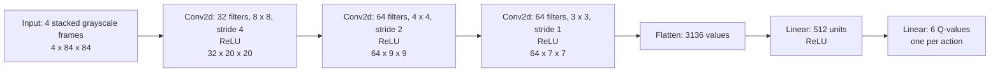
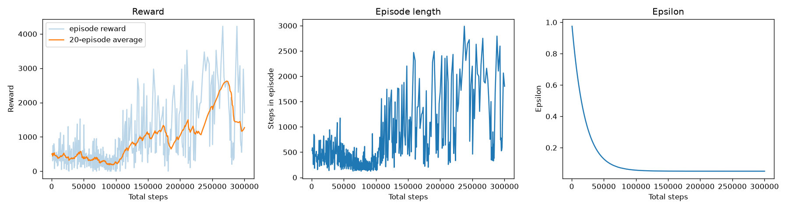

# Air Raid DQN

## 1. Project introduction

This project implements a Deep Q-Network (DQN) agent from scratch in PyTorch and Gymnasium. The selected Atari environment is **Air Raid** (`ALE/AirRaid-v5`). The player controls a ship to defend two buildings from flying saucers dropping bombs.

**Group members:**

- Hamse
- Amaliza
- Prince

## 2. DQN architecture

### Q-network

The environment observations are converted to grayscale, resized to `84 × 84`, and stacked over the four most recent frames. The CNN uses these frames to estimate one Q-value for each of Air Raid's six available actions.



The project uses two networks with this same architecture:

- **Online network:** selects actions and is updated by gradient descent.
- **Target network:** supplies the next-state Q-value in the Bellman target. Its weights are copied from the online network every 2,000 environment steps.

### Training process

1. The agent chooses an action using epsilon-greedy selection: it explores with probability ε and otherwise selects the action with the highest online Q-value. Epsilon decays exponentially during training.
2. Each transition `(state, action, reward, next state, done)` is added to a replay buffer with a capacity of 50,000 transitions.
3. After 5,000 transitions have been collected, the agent samples a batch of transitions (32 by default) every four environment steps.
4. The target network calculates the Bellman target:

   `target = reward + gamma * (1 - done) * max(target_network(next_state))`

   Rewards used for learning are clipped to their sign; episode scores reported in the experiment results are the original game rewards.

5. Smooth L1 loss compares the target with the online network's Q-value for the action taken. Adam updates the online network.
6. Training records episode reward, episode length, total environment steps, and epsilon. The checkpoint with the best rolling average over 20 episodes is saved for each experiment.

The network, replay buffer, and training logic are implemented in [`src/train.py`](src/train.py) and [`src/replay_buffer.py`](src/replay_buffer.py).

## 3. Running the project

Install dependencies with `uv`:

```bash
uv sync
```

Run commands from the repository root. Specify the member and experiment number:

```bash
uv run python src/train.py --member Hamse --exp 1
```

Each member's 10 experiments can be repeated with one command: `bash run_hamse.sh`, `bash run_amaliza.sh` or `bash run_prince.sh`.

The default training budget is 300,000 environment steps. A saved model, metrics, summary, and plot are written to the corresponding member's experiment folder.

To watch a saved model play in a window, pass its checkpoint path to `play.py` (without a path, it loads `dqn_model.pth` from the repository root):

```bash
uv run python src/play.py Hamse/exp01/dqn_model.pth
```

The project currently selects the CPU-only PyTorch package in `pyproject.toml`. Using a Kaggle GPU requires a CUDA-enabled PyTorch build in that environment.

## 4. Hyperparameter experiments

Each of us ran 10 experiments with the same training script and the same fixed settings (300,000 steps, seed 0). We split the hyperparameters between us so that, together, the group covers all six:

| Member | Focus | Report | Models and plots |
|--------|-------|--------|------------------|
| Hamse | Epsilon schedule (start, end and decay) | [Hamse's report](docs/Hamse_Hyperparameter_experiment_results.md) | [`Hamse/`](Hamse/) |
| Amaliza | Learning rate, and how it interacts with batch size, epsilon and gamma | [Amaliza's report](docs/Amaliza_Hyperparameter_experiment_results.md) | [`Amaliza/`](Amaliza/) |
| Prince | Gamma and batch size | [Prince's report](docs/Prince_Hyperparameter_experiment_results.md) | [`Prince/`](Prince/) |

**Our best run each** (best avg20 is the highest 20-episode average reward during training):

| Member | Best run | Learning rate | Gamma | Batch size | Epsilon start → end | Epsilon decay | Best avg20 | Final avg20 | Best game |
|--------|----------|---------------|-------|------------|---------------------|---------------|------------|-------------|-----------|
| Hamse | Exp 1 | 0.0001 | 0.99 | 32 | 1.0 → 0.05 | 20,000 | **2,626** | 1,271 | 4,225 |
| Prince | Exp 7 | 0.0001 | 0.99 | 64 | 1.0 → 0.05 | 100,000 | 1,975 | 1,378 | 3,925 |
| Amaliza | Exp 8 | 0.00005 | 0.99 | 32 | 1.0 → 0.05 | 50,000 | 1,803 | 1,009 | 4,350 |

## 5. Training performance of our best experiment (Hamse, Exp 1)

| Part of training | Episodes | Average episode length (steps) | Average reward | Highest reward |
|------------------|----------|--------------------------------|----------------|----------------|
| Steps 0–100k | 315 | 317 | 338 | 1,525 |
| Steps 100k–200k | 121 | 815 | 863 | 2,975 |
| Steps 200k–300k | 76 | 1,339 | 1,654 | 4,225 |
| **Whole run** | **512** | **586** (shortest 124, longest 2,989) | **657** | **4,225** |

The run lasted 300,184 environment steps. As epsilon decayed, the agent learned to survive much longer: its average episode was about 4 times longer in the last third of training than in the first, and it scored about 5 times more. Its best 20-episode average was 2,626, and its best single game was 4,225 points.



## 6. Gameplay demonstration

The video below shows the greedy DQN policy using the checkpoint with the highest recorded peak 20-episode average across all our experiments (`Hamse/exp01/dqn_model.pth`). For a compact demonstration, the recorded episode is capped at 1,200 agent steps.

<video controls width="640" src="videos/best_agent-episode-0.mp4">
  Air Raid gameplay demonstration using the trained DQN agent.
</video>

[Open or download the gameplay video](videos/best_agent-episode-0.mp4).

For the live demonstration, we run `play.py` with the same checkpoint. It plays greedily (always choosing the action with the highest Q-value) and shows the game in a window. The `dqn_model.pth` in the repository root is a copy of this checkpoint, so `play.py` uses it by default:

```bash
uv run python src/play.py
```

## 7. Task allocation

| Member | What they did |
|--------|---------------|
| Hamse | Set up the uv project; built the Q-network and target network, the first replay buffer and the training loop (`src/train.py`); organised the repository; wrote the README and recorded the gameplay video; ran 10 experiments on the epsilon schedule |
| Amaliza | Reworked the replay buffer into a fixed-size list that overwrites the oldest experiences; wrote `run_amaliza.sh`; ran 10 experiments on the learning rate; analysed the results |
| Prince | Group leader; pinned Python 3.13 so that `ale-py` and `torch` install correctly; wrote `src/play.py` for evaluation; added Apple GPU (MPS) support to training; ran 10 experiments on gamma and batch size |

Our completed team task sheet, with each member's role, the task tracker and our meeting log, is in [`Task allocation sheet.pdf`](Task%20allocation%20sheet.pdf).
