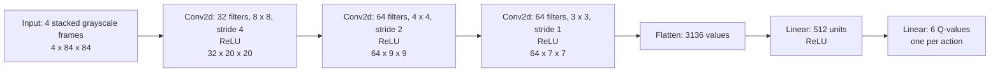

# Air Raid DQN

## 1. Project introduction

This project implements a Deep Q-Network (DQN) agent from scratch in PyTorch and Gymnasium. The selected Atari environment is **Air Raid** (`ALE/AirRaid-v5`). The player controls a ship to defend two buildings from flying saucers dropping bombs.

**Group members:**

- Hamse
- Amaliza
- Prince

## 2. DQN architecture

### Q-network

The environment observations are converted to grayscale, resized to `84 × 84`, and stacked over the four most recent frames. The CNN uses these frames to estimate one Q-value for each of Air Raid's six available actions.



The project uses two networks with this same architecture:

- **Online network:** selects actions and is updated by gradient descent.
- **Target network:** supplies the next-state Q-value in the Bellman target. Its weights are copied from the online network every 2,000 environment steps.

### Training process

1. The agent chooses an action using epsilon-greedy selection: it explores with probability ε and otherwise selects the action with the highest online Q-value. Epsilon decays exponentially during training.
2. Each transition `(state, action, reward, next state, done)` is added to a replay buffer with a capacity of 50,000 transitions.
3. After 5,000 transitions have been collected, the agent samples a batch of 32 transitions every four environment steps.
4. The target network calculates the Bellman target:

   `target = reward + gamma * (1 - done) * max(target_network(next_state))`

   Rewards used for learning are clipped to their sign; episode scores reported in the experiment results are the original game rewards.

5. Smooth L1 loss compares the target with the online network's Q-value for the action taken. Adam updates the online network.
6. Training records episode reward, episode length, total environment steps, and epsilon. The checkpoint with the best rolling average over 20 episodes is saved for each experiment.

The network, replay buffer, and training logic are implemented in [`src/train.py`](src/train.py) and [`src/replay_buffer.py`](src/replay_buffer.py). Experiment configurations and results are documented in [Hamse's report](docs/Hamse_Hyperparameter_experiment_results.md), [Amaliza's report](docs/Amaliza_Hyperparameter_experiment_results.md), and [Prince's report](docs/Prince_Hyperparameter_experiment_results.md).

## Running the project

Install dependencies with `uv`:

```bash
uv sync
```

Run commands from the repository root. Specify the member and experiment number:

```bash
uv run python src/train.py --member Hamse --exp 1
```

The default training budget is 300,000 environment steps. A saved model, metrics, summary, and plot are written to the corresponding member's experiment folder.

To watch a saved model play in a window, pass its checkpoint path to `play.py`:

```bash
uv run python src/play.py Hamse/exp01/dqn_model.pth
```

The project currently selects the CPU-only PyTorch package in `pyproject.toml`. Using a Kaggle GPU requires a CUDA-enabled PyTorch build in that environment.

## 6. Gameplay demonstration

The video below shows the greedy DQN policy using the checkpoint with the highest recorded peak 20-episode average across the saved experiments (`Hamse/exp01/dqn_model.pth`).

For a compact demonstration, the recorded episode is capped at 1,200 agent steps.

<video controls width="640" src="videos/best_agent-episode-0.mp4">
  Air Raid gameplay demonstration using the trained DQN agent.
</video>

[Open or download the gameplay video](videos/best_agent-episode-0.mp4).
