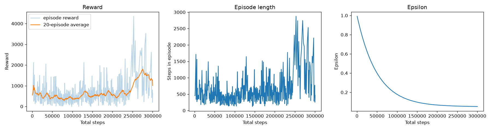
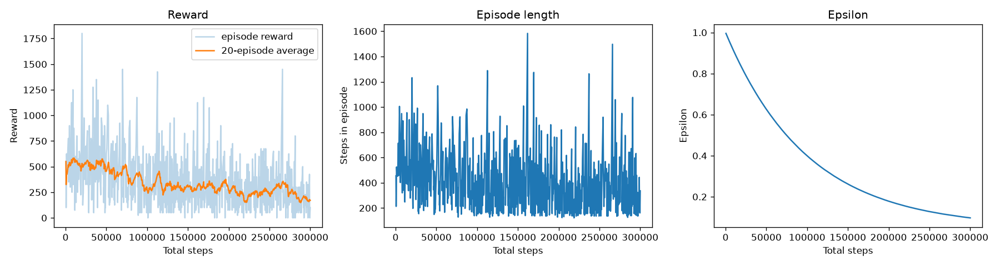

# Hyperparameter Experiment Results

**Member Name:** Amaliza

**Environment:** `ALE/AirRaid-v5`

## How I ran my experiments

I ran 10 experiments, each with a different combination of hyperparameters, using our group's `src/train.py`. I defined all 10 runs in `run_amaliza.sh`, so anyone can repeat them with one command. My models, metrics and plots are in `Amaliza/expXX/` (`dqn_model.pth`, `metrics.csv`, `plot.png`, `summary.json`).

**My part in the group:** my focus was the **learning rate** (Exp 1–6 test six learning rates from 0.001 down to 0.00001). In Exp 7–10 I took the most interesting learning rates and changed one other setting each (batch size, epsilon decay, gamma, epsilon end) to see how they interact with the learning rate. Hamse's experiments go deeper into the epsilon schedule and Prince's into gamma and batch size, so together our group covers all six hyperparameters.

I kept these settings the same in every run, so that only the six hyperparameters I was testing changed the result:

| Fixed setting | Value |
|---------------|-------|
| Training length | 300,000 environment steps |
| Replay buffer size | 50,000 transitions |
| Learning starts after | 5,000 steps |
| Network update | every 4 steps |
| Target network update | every 2,000 steps |
| Random seed | 0 |
| Reward used for learning | clipped to its sign (scores I report are the real game scores) |

My laptop has no GPU and not enough RAM for the 50,000-transition replay buffer, so I trained on free cloud GPUs:

| Experiments | Where I ran them | Why |
|-------------|------------------|-----|
| 1 | Google Colab (NVIDIA T4 GPU) | First platform I used |
| 2–10 | Kaggle (NVIDIA T4 GPU) | Colab's free GPU ran out after experiment 1 |

Both use the same code, settings and seed, and each run took about 12–15 minutes.

**How I read the numbers:**

| Column | Meaning |
|--------|---------|
| Start avg | Average score of the first 20 episodes. Epsilon is close to 1.0 there, so this is roughly what **random play** scores (about 450–620). |
| Best avg20 | Best 20-episode average during training. This is when `dqn_model.pth` was saved. |
| End avg | Average score of the last 20 episodes, when the agent mostly plays greedily (epsilon around 0.05–0.15). |
| Best episode | Highest score in a single game. |

I say an agent **learned** if its scores at the end are clearly above random play.

## Results

| Exp | Learning rate | Gamma | Batch size | Epsilon start | Epsilon end | Epsilon decay (steps) | Start avg | Best avg20 | End avg | Best episode | Observed behaviour |
|-----|---------------|-------|------------|---------------|-------------|-----------------------|-----------|------------|---------|--------------|--------------------|
| 1 | 0.0001 | 0.99 | 32 | 1.0 | 0.05 | 100000 | 578 | 1295 | **1295** | 3325 | My baseline, and it learned steadily. Its scores improved in every third of training (454 -> 612 -> 754), and its best 20-episode average came at the very end, so it was still improving when training stopped. Episodes more than doubled in length (552 -> 1194 steps), meaning the agent learned to survive much longer. It had the highest final average of all my runs. |
| 2 | 0.001 | 0.99 | 32 | 1.0 | 0.05 | 100000 | 476 | 655 | 203 | 1825 | Did not learn. Its best average came early (step ~33k), while it was still mostly playing randomly. After that, scores fell to about 200, worse than random play, and episodes got shorter (484 -> 349 steps). I think the learning rate was too high, so the Q-values became unstable. |
| 3 | 0.0005 | 0.99 | 32 | 1.0 | 0.05 | 100000 | 591 | 773 | 326 | 2150 | Did not learn. I saw the same pattern as Exp 2: a peak at step ~17k (still the random phase), then a steady decline to about 330. The learning rate was still too high. |
| 4 | 0.00025 | 0.99 | 32 | 1.0 | 0.05 | 100000 | 595 | 819 | 324 | 2950 | Unstable. Scores dropped in the middle of training, recovered in the last third (average 529) and reached a best average of 819 at step ~233k, but ended low again (324). It learned something, but not reliably with batch 32. |
| 5 | 0.00005 | 0.99 | 32 | 1.0 | 0.05 | 100000 | 463 | 839 | 790 | 2375 | Learned slowly but steadily. The last third of training averaged 660 (vs 476 in the first third), and the final average (790) stayed close to its best. Episodes got longer (493 -> 736 steps), so the agent survived longer. One of my most stable runs. |
| 6 | 0.00001 | 0.99 | 32 | 1.0 | 0.05 | 100000 | 543 | 796 | 290 | 1925 | Did not learn. Its best average came at step ~25k, during the random phase. The learning rate was so small that the network barely changed in 300k steps, so once epsilon dropped and the agent followed its own Q-values, it played worse than random. |
| 7 | 0.00025 | 0.99 | 64 | 1.0 | 0.05 | 100000 | 619 | 1321 | 986 | 3800 | Learned well. Scores rose through training (thirds: 517 -> 858 -> 991) and episodes got longer (585 -> 802 steps). It has the same learning rate as Exp 4 but batch 64, and it was much better and more stable: a bigger batch gives a less noisy gradient. |
| 8 | 0.00005 | 0.99 | 32 | 1.0 | 0.05 | 50000 | 606 | **1803** | 1009 | **4350** | **My best run.** It was flat for the first ~230k steps, then rose strongly: the 20-episode average climbed to 1,803 at step ~276k, with a best single game of 4,350 and episodes of up to ~2,900 steps. It has the same learning rate as Exp 5, but epsilon decays twice as fast, so the agent spent more of training using (and correcting) its own policy. |
| 9 | 0.0005 | 0.95 | 32 | 1.0 | 0.05 | 100000 | 566 | 575 | 171 | 1800 | **My worst run.** It never beat random play: the average fell steadily to 171 and episodes got shorter (555 -> 245 steps). A high learning rate together with a lower gamma (a shorter-sighted agent) did even worse than Exp 3. |
| 10 | 0.00025 | 0.99 | 32 | 1.0 | 0.1 | 100000 | 569 | 1434 | 680 | 3300 | Learned. Its best average was 1,434 at step ~198k, and scores improved through training (thirds: 527 -> 570 -> 755). Compared with Exp 4 (same settings but epsilon end 0.05), keeping 10% exploration made learning clearly better and more stable. |

## My best and worst configuration

| | Exp | Learning rate | Gamma | Batch | Epsilon decay | Best avg20 | End avg | Best episode |
|---|-----|---------------|-------|-------|---------------|------------|---------|--------------|
| **Best** | 8 | 0.00005 | 0.99 | 32 | 50,000 | **1,803** | 1,009 | **4,350** |
| **Worst** | 9 | 0.0005 | 0.95 | 32 | 100,000 | 575 | **171** | 1,800 |

- **Best: Exp 8** (lr 0.00005, gamma 0.99, batch 32, epsilon 1.0 -> 0.05 with decay 50,000). It reached my highest 20-episode average (**1,803**) and my best single game (**4,350**). Its peak average is about 3x what random play scores, and it still ended at **1,009**. I believe the small learning rate kept the updates stable, while the faster epsilon decay gave the agent more time to learn from its own (greedy) play.
- **Worst: Exp 9** (lr 0.0005, gamma 0.95). It never did better than random play and ended at **171**. The large updates made the Q-values unstable, and the lower gamma made the agent care less about future rewards, which does not help in a game where surviving longer is what earns points.

## What helped and what hurt

**The learning rate was the most important setting.** With batch 32, gamma 0.99 and the default epsilon:

| Learning rate | Exp | Best avg20 | End avg | What I saw |
|---------------|-----|------------|---------|------------|
| 0.001 | 2 | 655 | 203 | Too high: collapsed below random play |
| 0.0005 | 3 | 773 | 326 | Too high: collapsed below random play |
| 0.00025 | 4 | 819 | 324 | Unstable, with ups and downs |
| 0.0001 | 1 | 1,295 | 1,295 | Steady improvement, still rising at the end |
| 0.00005 | 5 | 839 | 790 | Slow but steady improvement |
| 0.00001 | 6 | 796 | 290 | Too low: the network barely learned in 300k steps |

**Changing one setting at a time** (each pair differs in only one hyperparameter):

| Hyperparameter | Compared | Result | Effect | Why I think it happened |
|----------------|----------|--------|--------|-------------------------|
| Batch size | Exp 4 (32) vs Exp 7 (64) | End avg 324 -> **986** | Helped | Averaging the loss over more experiences makes each update less noisy. |
| Epsilon decay | Exp 5 (100,000) vs Exp 8 (50,000) | Best avg 839 -> **1,803** | Helped | With the slower decay, the agent was still acting randomly for a large part of training. |
| Epsilon end | Exp 4 (0.05) vs Exp 10 (0.1) | Best avg 819 -> **1,434** | Helped | Keeping 10% exploration stopped the agent from getting stuck in a poor policy. |
| Gamma | Exp 3 (0.99) vs Exp 9 (0.95) | End avg 326 -> **171** | Hurt | A shorter-sighted agent values survival less, and surviving longer is what earns points in Air Raid. |

**Episode length followed the reward:** in the runs that learned (1, 5, 7, 8, 10), episodes got longer because the agent survived longer. In the runs that failed (2, 3, 6, 9), episodes got shorter.

## Training performance of my best experiment (Exp 8)

| Part of training | Episodes | Average episode length (steps) | Average reward | Highest reward |
|------------------|----------|--------------------------------|----------------|----------------|
| Steps 0–100k | 231 | 433 | 458 | 2,125 |
| Steps 100k–200k | 192 | 519 | 540 | 2,125 |
| Steps 200k–300k | 128 | 787 | 904 | 4,350 |
| **Whole run** | **551** | **545** (shortest 124, longest 2,873) | **590** | **4,350** |

In total I trained for 300,367 environment steps (about 12.6 minutes on the GPU). In the last third of training the agent survived about 80% longer per episode and scored about twice as much as in the first third. My best single game (4,350 points, 2,873 steps long) came at step 252,935.

For comparison, my worst run (Exp 9) went the other way: its scores and episode lengths shrank as epsilon dropped.

## My final configuration and why I chose it

**lr 0.00005, gamma 0.99, batch 32, epsilon 1.0 -> 0.05 with decay 50,000 (Exp 8).** It had the best 20-episode average and the best single game of my 10 runs, and it improved strongly in the last part of training. Its saved `dqn_model.pth` (taken at its best average) is my strongest model for `play.py`.

Exp 1 (lr 0.0001) is a close alternative: it had the highest *final* average (1,295) and was still improving when training stopped, so with more training steps it might catch up.

**What I would keep in mind:** 300,000 steps is short for Atari, and Air Raid scores vary a lot from one game to the next, so I would not over-interpret small differences between runs. The large gaps (for example Exp 8 vs Exp 9) are the conclusions I trust most. My next step would be to combine my best findings: a low learning rate (0.00005–0.0001) with batch 64, the faster epsilon decay, and more training steps.
